<p align="center">
  <a href="https://devon-chonnam-3.duckdns.org">
    <picture>
      <source media="(prefers-color-scheme: dark)" srcset="docs/assets/devon-logo-dark.png" />
      
    </picture>
  </a>
</p>

<p align="center">
  <strong>GitHub 저장소 기반 AI 모의면접</strong><br/>
  내 코드와 지원 공고를 근거로 질문을 받고, 음성으로 답한 뒤, 항목별 점수와 피드백으로 돌아봅니다.
</p>

<p align="center">
  <a href="https://devon-chonnam-3.duckdns.org">서비스</a> &nbsp;·&nbsp;
  <a href="#5-아키텍처">아키텍처</a> &nbsp;·&nbsp;
  <a href="#9-시작하기">시작하기</a> &nbsp;·&nbsp;
  <a href="#10-테스트">테스트</a> &nbsp;·&nbsp;
  <a href="#12-문서">문서</a>
</p>

<p align="center">
  <a href="https://github.com/kakaotechcampus-4/ktc4-chonnam-3/actions/workflows/backend-ci.yml"></a>
  <a href="https://github.com/kakaotechcampus-4/ktc4-chonnam-3/actions/workflows/ai-ci.yml"></a>
  <a href="https://github.com/kakaotechcampus-4/ktc4-chonnam-3/actions/workflows/frontend-ci.yml"></a>
  
  
  
  
  
</p>

<p align="center">
  공고 URL을 넣으면 내 공개 저장소 중 면접에 맞는 프로젝트를 추천합니다.<br/>
  AI 면접관은 실제 코드를 확인하며 9턴 동안 질문하고, 답변과 코드가 어긋나는 지점까지 짚습니다.
</p>

---

<br/>

## 1. 주요 기능

| 기능 | 설명 |
|------|------|
| **GitHub 연동** | GitHub OAuth로 로그인하면 공개 저장소 목록을 백그라운드에서 수집합니다. |
| **공고 기반 저장소 추천** | Wanted 공고의 요구사항과 저장소 분석 결과를 맞춰 면접 후보를 추천합니다. |
| **지원 서류 연결** | 자기소개서(PDF, DOCX)와 포트폴리오(PDF)를 올릴 수 있고, 포트폴리오에 적힌 GitHub 저장소를 후보 선정에 반영합니다. |
| **음성 면접** | 질문을 음성으로 듣고 마이크로 답변하면, 답변이 텍스트로 전사되어 면접이 이어집니다. |
| **코드 근거 질문** | 질문과 평가의 근거가 된 파일과 커밋을 저장하고, 근거를 확인할 때 저장소와 파일 이름을 화면에 표시합니다. |
| **세 가지 면접 관점** | 기술, 인사, 도메인 관점을 Director 하나가 답변 흐름에 맞춰 선택합니다. |
| **면접 리포트** | 0~100점 항목 6개와 면접관 관점별 강점, 개선점을 제공합니다. |
| **면접 이력과 재도전** | 지난 리포트를 다시 보고, 같은 조건으로 다시 도전할 수 있습니다. |

<br/>

## 2. 서비스 둘러보기

> 아래 화면은 개발용 Mock 데이터로 촬영했습니다. 사용자와 면접 내용은 예시입니다.

<br/>

### 2.1 로그인과 저장소 수집

GitHub 계정으로 로그인합니다. GitHub 토큰은 서버에서 암호화해 보관하며 브라우저로 전달하지 않습니다.

<p align="center">
  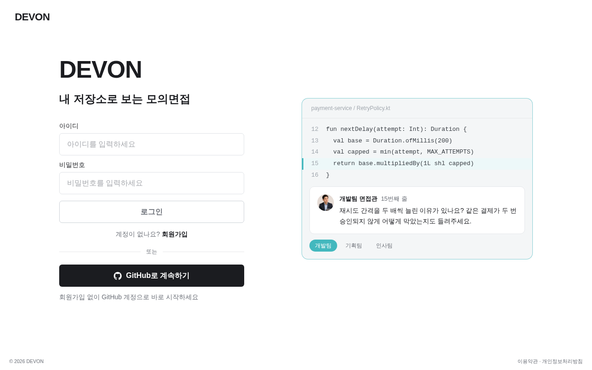
  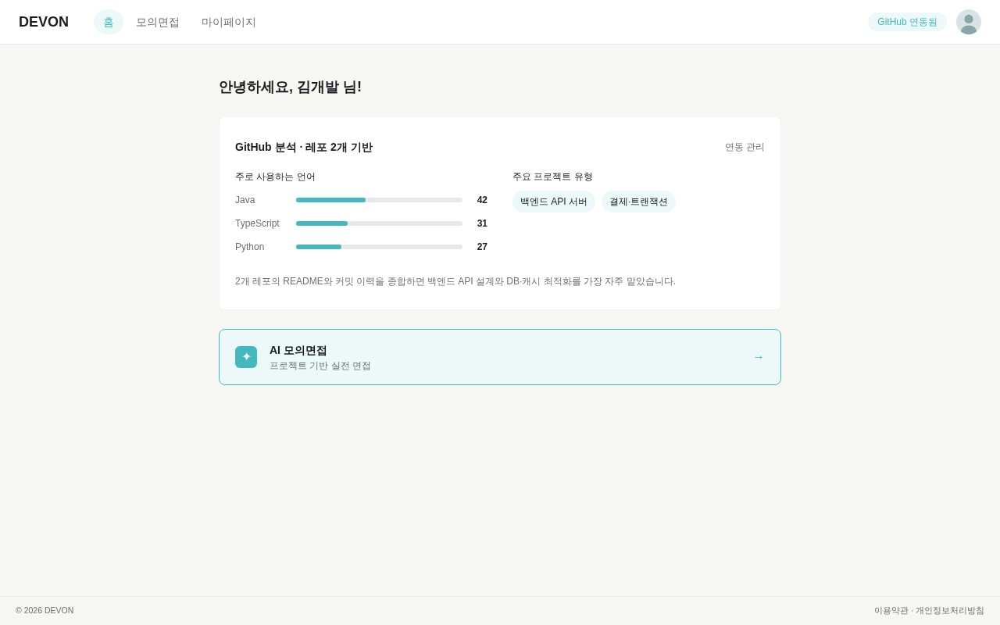
</p>

<br/>

### 2.2 공고 입력과 분석

Wanted 공고 URL을 입력하고 필요하면 자기소개서와 포트폴리오를 올립니다. 분석 진행 상황은 단계별로 실시간 표시됩니다.

<p align="center">
  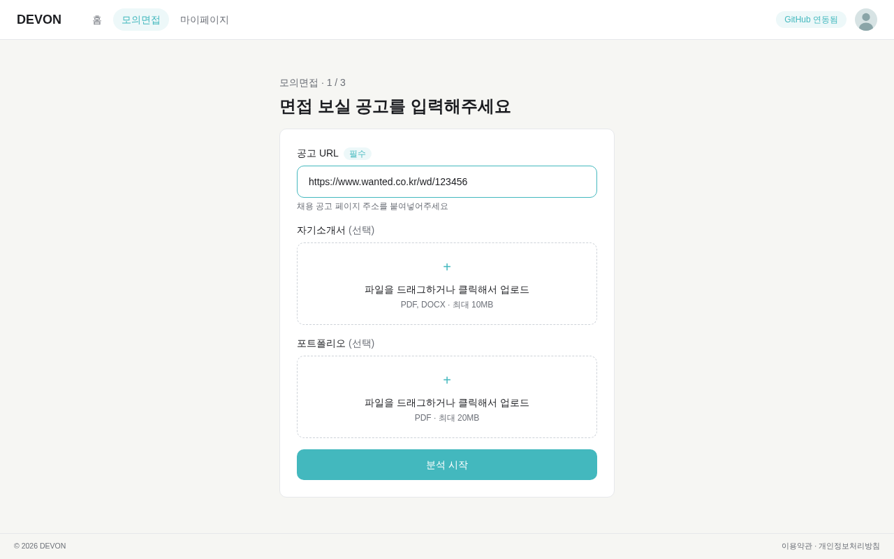
  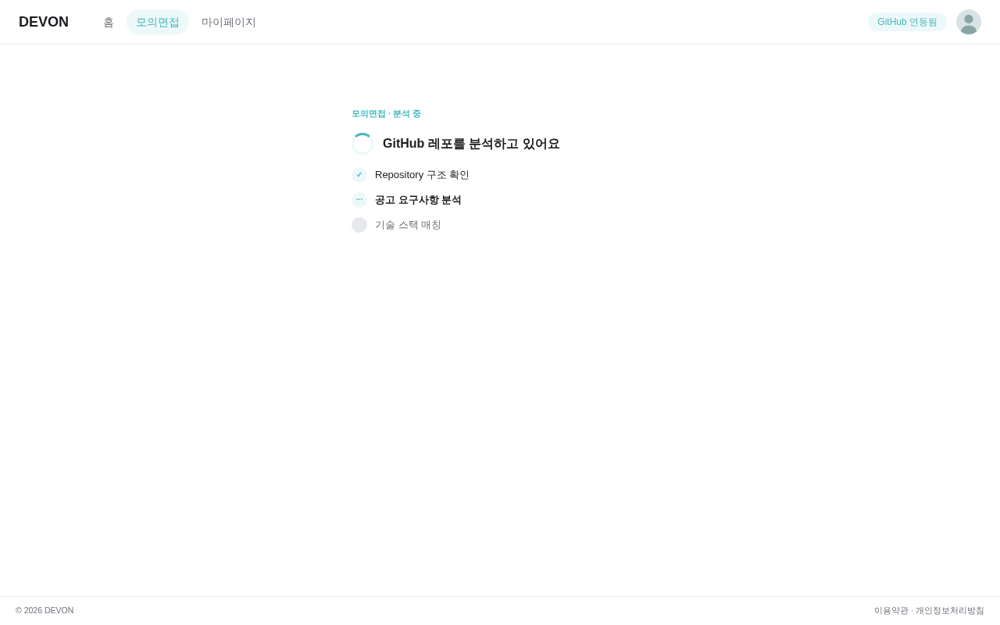
</p>

<br/>

### 2.3 면접 저장소 선택

공고에 맞게 정렬된 후보에서 1~5개를 고릅니다. 원하는 저장소가 없으면 더 보기로 다음 후보를 추가로 분석합니다.

<p align="center">
  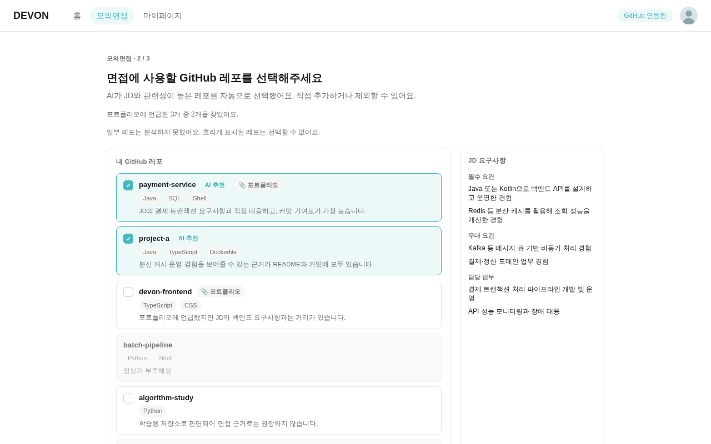
</p>

<br/>

### 2.4 면접 준비

마이크를 점검하는 동안, 서버가 선택한 저장소를 깊게 분석해 첫 질문까지 준비합니다.

<p align="center">
  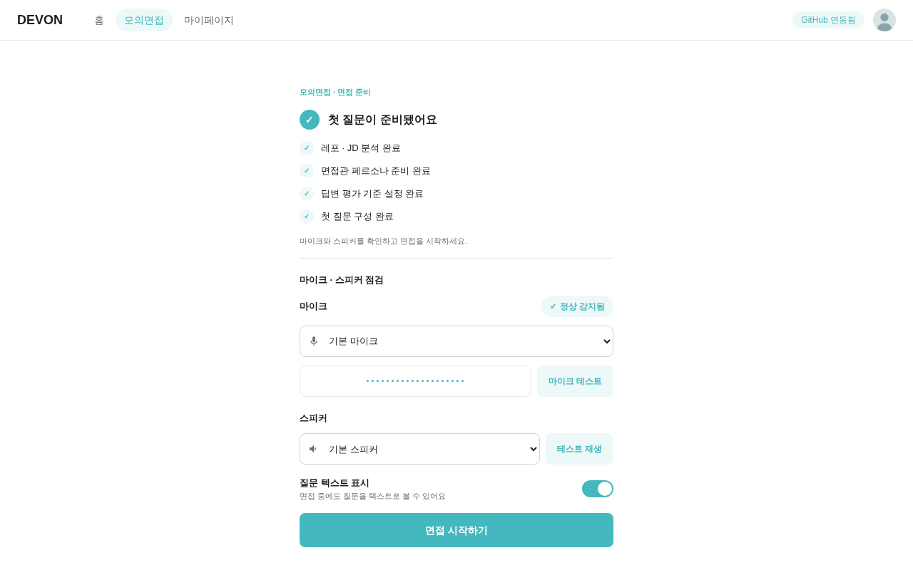
</p>

<br/>

### 2.5 면접 진행

9턴 동안 음성으로 답변합니다. 첫 질문은 긴장을 풀기 위한 인사 관점 질문이고, 답변을 마치면 전사된 텍스트가 표시됩니다. 답변을 제출하면 필요할 때 코드 근거를 확인하고, 그 결과에 따라 다음 질문을 이어갑니다.

<p align="center">
  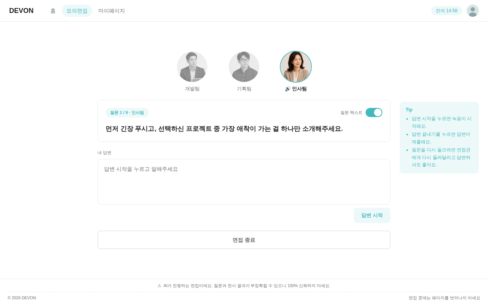
  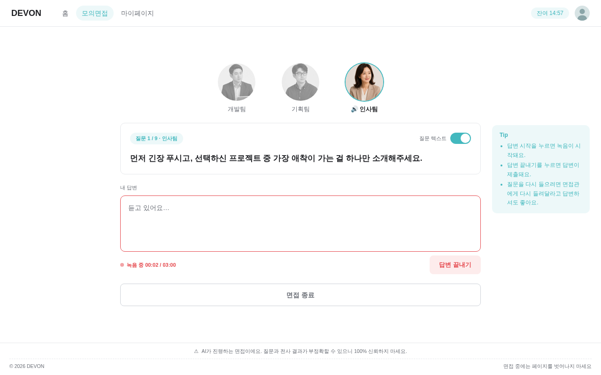
</p>
<p align="center">
  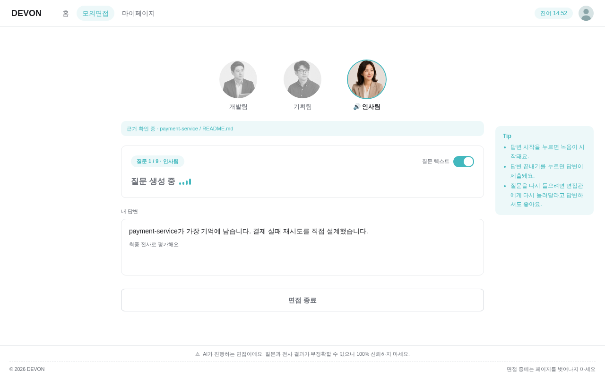
  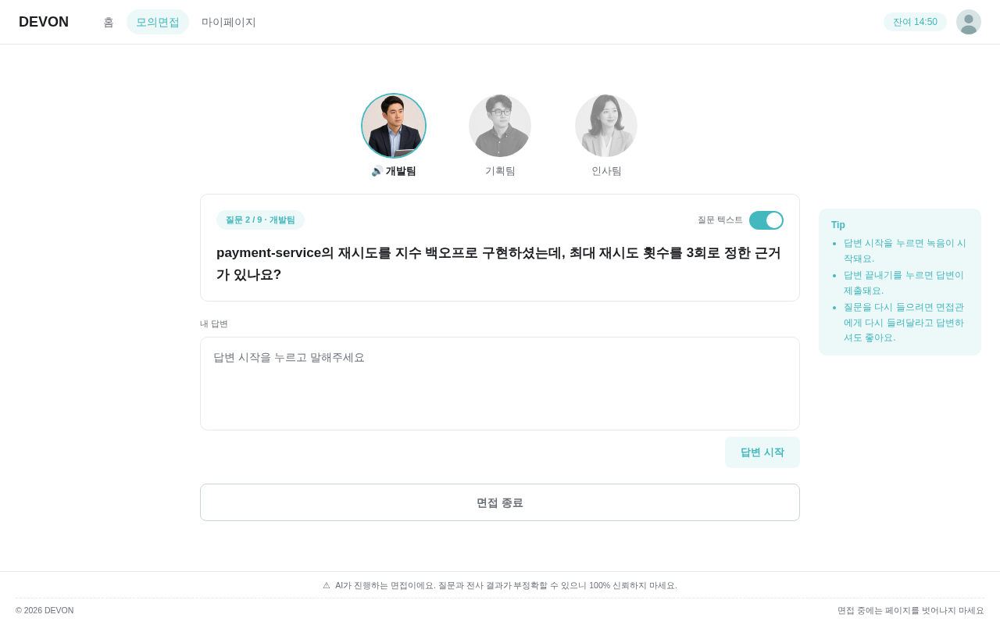
</p>

<br/>

### 2.6 리포트와 마이페이지

리포트는 처음 열 때 생성되며, 항목별 점수와 관점별 강점·개선점을 보여줍니다. 생성이 끝나면 프로필 요약도 함께 갱신되고, 마이페이지에서 지난 면접을 다시 보거나 재도전할 수 있습니다.

<p align="center">
  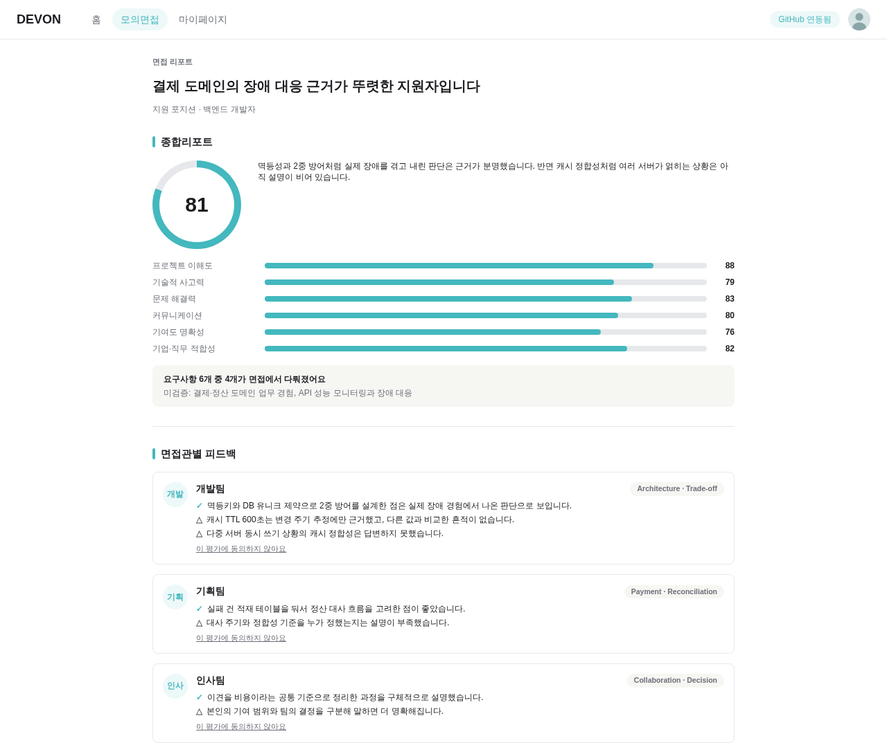
</p>
<p align="center">
  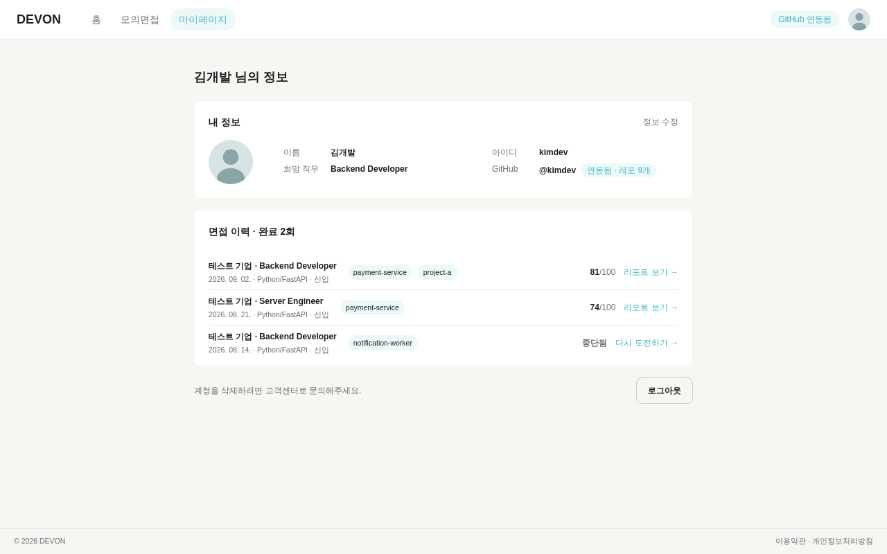
</p>

<br/>

## 3. 지원 범위

| 항목 | 범위 |
|------|-----------|
| 저장소 | Public GitHub 저장소만 지원합니다. |
| 공고 | Wanted 공고만 지원하며, 공고 없이는 면접을 만들 수 없습니다. |
| 답변 방식 | 음성으로 답변합니다. |
| 면접 길이 | 꼬리질문을 포함해 9턴이며, AI가 임의로 일찍 끝내지 않습니다. |
| 동시 진행 | 분석 실행 하나당 진행 중인 면접은 하나입니다. |
| 중단 | 면접은 사용자가 직접 나가거나 저장소를 다시 선택할 때만 중단 처리됩니다. |

<br/>

## 4. 기술 스택

| 영역 | 기술 |
|------|------|
| Frontend | React 19, TypeScript, Vite, Tailwind CSS, React Router, TanStack Query |
| Backend | FastAPI, Pydantic v2, SQLAlchemy 2.0 async, Alembic |
| AI | `devon_ai` 로컬 Python 패키지, OpenAI `gpt-5.6-luna` (설정으로 변경 가능) |
| 음성 | OpenAI 호환 STT(기본 `whisper-large-v3`), Google Cloud Chirp 3 HD TTS(선택) |
| 데이터 | PostgreSQL 15, Redis 7 |
| 비동기 작업 | ARQ |
| 실시간 통신 | WebSocket(면접), SSE(분석 진행) |
| 배포 | Docker Compose, Caddy, AWS EC2, GitHub Actions |
| 테스트 | pytest, Playwright, MSW |
| 코드 품질 | uv, ruff, mypy, ESLint, Prettier |

<br/>

## 5. 아키텍처

<p align="center">
  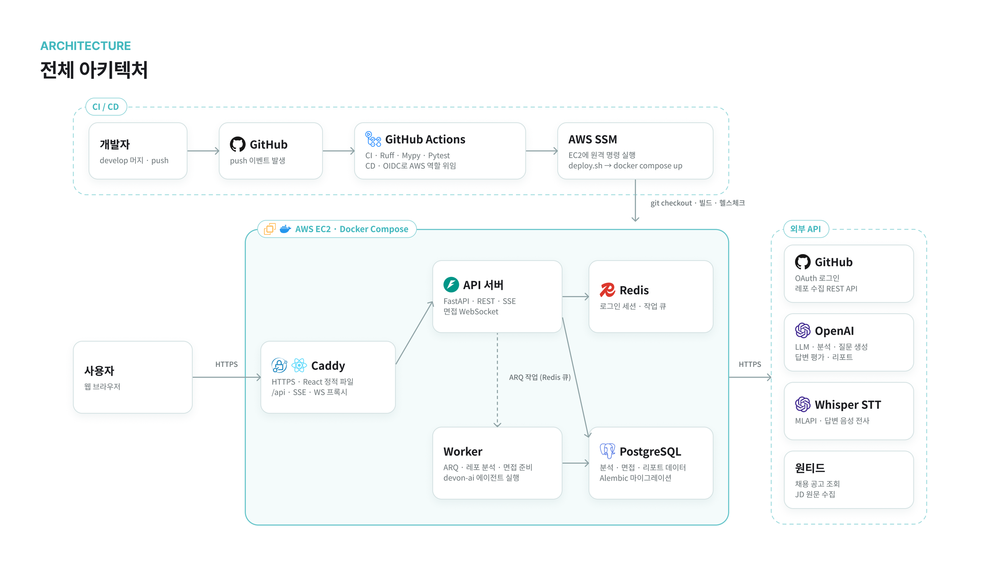
</p>

AI 기능은 별도 서버가 아니라 API와 Worker가 불러 쓰는 패키지입니다. 권한 확인, 상태 변경, 저장은 Backend가 맡고, AI는 주입받은 데이터로 판단만 합니다.

<br/>

### 주요 모듈

| 모듈 | 위치 | 책임 |
|------|------|------|
| **화면** | `frontend/src/features/` | 로그인, 홈, 분석, 면접, 리포트, 마이페이지 |
| **API 기능** | `backend/app/features/` | 기능별 `router → service → queries` 구조 |
| **비동기 작업** | `backend/app/workers/` | ARQ 작업 등록과 주기적 복구 |
| **실시간** | `backend/app/realtime/` | SSE, WebSocket, Redis 메시지 전달 |
| **외부 연동** | `backend/app/integrations/` | GitHub, Wanted, 문서 추출, LLM 클라이언트 |
| **AI 원본** | `ai/src/devon_ai/` | Director, LLM 작업, 입출력 계약과 검증 |
| **AI 평가** | `ai/evals/` | 프롬프트와 모델 품질 평가 |

<br/>

### 분석 파이프라인

공고를 제출하면 `analysis_run` 작업이 아래 순서로 실행되고, 진행 상황을 SSE로 전달합니다.

| 단계 | 하는 일 |
|------|---------|
| `doc_extract` | 업로드한 문서의 추출 결과를 확인하고 포트폴리오의 GitHub URL을 후보 선정에 연결 (문서를 올린 경우) |
| `repo_select` | 공개 저장소에서 후보를 고르고 분석 묶음 배정 |
| `repo_detail` | 후보 저장소의 상세 정보 수집 |
| `jd_fetch` | Wanted 공고 수집 |
| `jd_extract` | 공고에서 요구사항 추출 |
| `repo_analyze` | 후보 저장소 분석 |
| `match_score` | 공고 요구 기술과 저장소의 관련성 판단 |

<br/>

### 면접 한 턴의 흐름

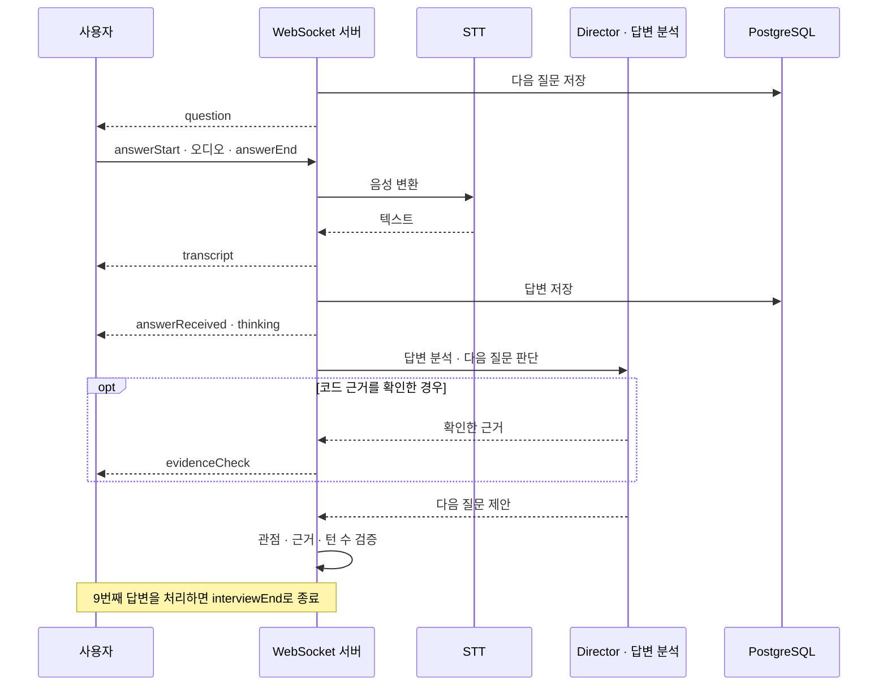

<br/>

## 6. AI 면접 설계

면접을 제어하는 Agent는 **Director 하나**입니다. 아래 관점은 별도 Agent가 아니라 Director가 질문할 때 선택하는 역할입니다.

| 관점 | 질문 내용 |
|------|-----------|
| `tech_lead` | 코드, 아키텍처, 기술 판단, 답변과 코드의 일치 여부 |
| `hr_manager` | 긴장 완화, 협업, 기여도, 의사결정, 이전 답변 기반 꼬리질문 |
| `domain_lead` | 금융, 게임, 여행, 쇼핑, 의료, 모빌리티 등 산업과 서비스 관점 |

<br/>

### LLM 사용처

| 작업 | 실행 위치 | 하는 일 |
|------|-----------|---------|
| 공고 도메인 분류 | `analysis_run` | 공고의 산업·서비스 도메인 분류 |
| 저장소 분석(L1) | `analysis_run`, `candidate_page_analyze` | 후보 저장소를 빠르게 분석해 추천 근거 생성 |
| 저장소 심층 분석(L2) | `interview_prep` | 핵심 저장소 1~2개를 깊게 분석하고 질문할 지점 정리 |
| 질문 결정 | 면접 WebSocket | 다음 관점, 주제, 꼬리질문 목적을 정하고 질문 생성 |
| 답변 분석 | 면접 WebSocket | 답변의 충분성, 정확성, 개인 기여를 판단 |
| 리포트 생성 | `report_generate` | 면접 전체를 평가하고 항목별 점수와 피드백 작성 |
| 프로필 요약 | `profile_summary` | 완료한 면접을 바탕으로 프로필 요약 갱신 |

모델 이름은 코드에 고정하지 않고 설정에서 읽습니다. 실제 사용한 모델과 프롬프트 버전을 DB에 기록하고, 저장소 분석과 면접 중 LLM 호출은 시도별 토큰과 지연 시간도 남깁니다.

<br/>

### 리포트 점수

프로젝트 이해도, 기술적 근거, 문제 해결 능력, 의사소통 명확성, 기여도 명확성, 직무 적합성의 6개 항목을 0~100점으로 평가합니다. 총점은 6개 항목의 단순 평균이며 가중치는 두지 않습니다.

<br/>

### AI 품질 원칙

- 저장소와 문서에 들어 있는 지시문은 분석 대상일 뿐, 시스템 지침이나 접근 범위를 바꿀 수 없습니다.
- 모델 응답은 구조 검사와 의미·권한·참조 검사를 통과해야 사용합니다.
- 질문, 답변, 원문 인용, 모델 요약, 개인 기여 주장을 구분해 저장합니다.
- 근거를 찾지 못한 것을 사용자의 거짓이나 낮은 역량으로 해석하지 않습니다.

<br/>

## 7. 안정성

PostgreSQL을 업무 데이터의 원본으로 둡니다. 대기 중인 분석과 면접 준비 작업은 Redis 큐에서 사라져도 DB 상태를 기준으로 다시 등록하고, 결정적인 job ID로 중복 실행을 막습니다.

| 주기 작업 (30초) | 역할 |
|------------------|------|
| `analysis_reaper` | 큐에 없는 대기 분석 작업과 후보 페이지 재등록 |
| `interview_prep_reaper` | 등록되지 않은 면접 준비 작업 재등록 |
| `interview_preparation_reaper` | 시간이 초과된 면접 준비를 재시도 가능한 실패로 전환 |
| `profile_refresh_reaper` | 전달되지 못한 프로필 갱신 재등록 |

실행 중인 작업을 자동으로 다시 시작하거나 면접을 자동으로 중단 처리하지는 않습니다.

<br/>

## 8. API

| 방식 | 경로 | 용도 |
|------|------|------|
| REST | `/me`, `/me/home`, `/me/profile`, `/me/interviews` | 사용자, 홈, 프로필, 면접 이력 |
| REST | `/documents/preview` | 포트폴리오 문서 미리보기 |
| REST | `/analysis-runs`, `/analysis-runs/{runId}/result`, `/analysis-runs/{runId}/candidates` | 분석 실행과 추천 결과, 후보 더 보기 |
| SSE | `/api/analysis-runs/{runId}/events` | 분석 진행 알림 |
| REST | `/interviews`, `/interviews/{id}`, `/interviews/{id}/abandon`, `/interviews/{id}/retry` | 면접 생성, 조회, 중단, 재도전 |
| REST | `/interviews/{id}/turns/{turn}/question-audio` | 질문 음성 |
| WebSocket | `/api/ws/interviews/{sessionId}` | 질문과 음성 답변 교환 |
| REST | `/interviews/{id}/report`, `/interviews/{id}/report/retry` | 리포트 조회와 재생성 |

REST 경로는 배포 환경에서 `/api` 아래에 있습니다. 요청·응답 형식은 [OpenAPI 명세](spec/shared/contracts/openapi.yaml), WebSocket과 SSE 메시지는 [FE API 명세](frontend/docs/api-spec.md)를 기준으로 합니다.

<br/>

## 9. 시작하기

### 화면만 실행하기

Mock API가 기본으로 켜져 있어 Backend 없이 화면을 볼 수 있습니다.

```bash
cd frontend
npm install
npm run dev
```

`http://localhost:5173`에 접속합니다.

<br/>

### 전체 서비스 실행하기

**준비물:** Python 3.12, [uv](https://docs.astral.sh/uv/), Node.js, Docker, GitHub OAuth App, LLM API 키, STT API 키

1. 환경 변수 파일을 만듭니다.

   ```bash
   cd backend
   cp .env.example .env
   ```

   GitHub OAuth App은 [로컬 실행 안내](backend/docs/local-oauth.md), LLM은 [LLM 연결 안내](backend/docs/llm-connection.md)에 따라 설정합니다. 음성 답변에는 `.env`의 `STT_PROVIDER`, `STT_BASE_URL`, `STT_API_KEY`가 필요합니다.

2. DB와 Redis를 띄우고 초기 데이터와 프롬프트를 등록한 뒤 API를 실행합니다.

   ```bash
   cd backend
   docker compose up -d db redis
   uv sync --locked
   uv run alembic upgrade head
   uv run python -m scripts.seed_all
   uv run python -m scripts.configure_ai_runtime --output /tmp/ai-runtime.json --apply
   uv run uvicorn app.main:app --reload --port 8000 --no-access-log
   ```

3. 다른 터미널에서 Worker를 실행합니다.

   ```bash
   cd backend
   uv run arq app.workers.analysis_app.WorkerSettings
   ```

4. Frontend를 실제 API에 연결합니다. Vite가 `/api` 요청을 `localhost:8000`으로 전달합니다.

   ```bash
   cd frontend
   echo "VITE_USE_MSW=false" > .env.local
   npm install
   npm run dev
   ```

배포 구성은 [`compose.deploy.yaml`](compose.deploy.yaml)과 [배포 안내](backend/docs/deploy.md)를 참고하세요.

<p align="center">
  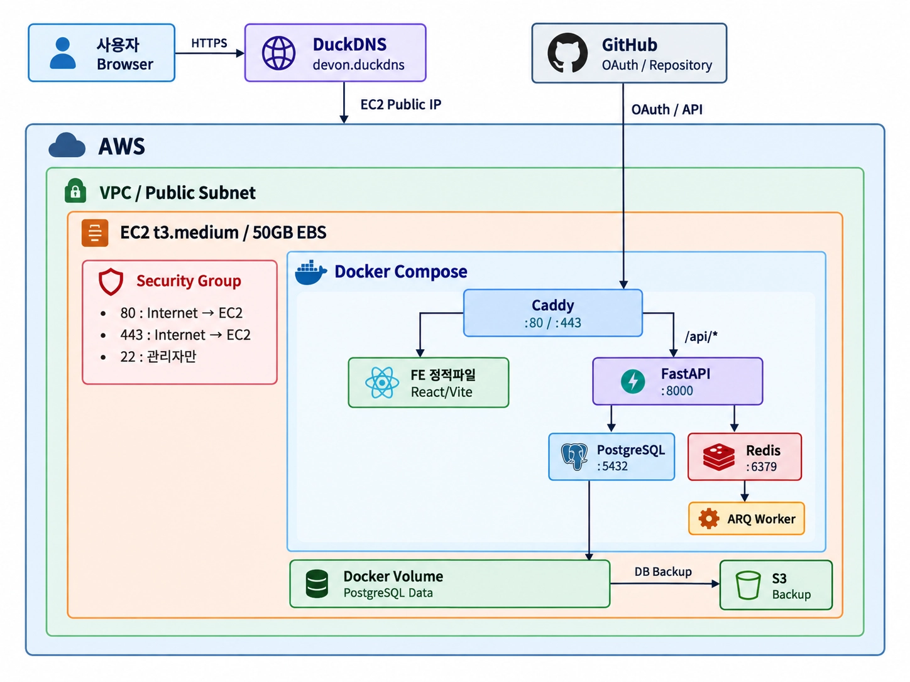
</p>

<br/>

## 10. 테스트

외부 서비스(GitHub, 공고 사이트, LLM)는 고정 응답이나 mock client로 대신하고, DB와 Redis는 실제 PostgreSQL·Redis로 검증합니다. 실제 모델은 AI 평가에서만 호출해 비용과 비결정성을 일반 테스트와 분리합니다.

<br/>

### 테스트 계층

| 계층 | 검증 대상 | 도구 · 위치 | 실행 시점 |
|------|-----------|-------------|-----------|
| 정적 검사 | 코드 스타일 · 타입 | Ruff · Mypy (backend · ai), ESLint · `tsc` (frontend) | PR · push |
| 단위 | 순수 로직, 스키마, 쿼터, mock LLM 출력 | pytest · `ai/tests`, `backend/tests/core` · `llm_tasks` · `agents` | PR · push |
| 통합 (Backend) | PostgreSQL 저장 · 제약, Redis 복구, 워커 · WebSocket · API | pytest-asyncio · `backend/tests/features` · `integrations` · `realtime` | PR · push |
| 계약 | OpenAPI 스키마와 코드 enum의 값 일치, 계약 형식 | `backend/tests/contract` (`openapi.yaml`을 직접 읽음), `.claude/scripts/check_contracts.py` | PR · push |
| 마이그레이션 | Alembic 업그레이드 · 스키마 그래프 | `backend/tests/test_analysis_migration.py` · `test_analysis_storage_upgrade.py` 등 | PR · push (backend · ai 변경 시) |
| Frontend 단위 | 순수 로직 · API 래퍼 · 면접 중단 분기 · 작은 컴포넌트 | Vitest + Testing Library (`frontend/src/**/*.test.ts(x)`) | PR · push |
| Frontend E2E | 화면별 흐름 · 실패 · 재시도 · 음성/텍스트 모드 | Playwright + MSW 목 (`frontend/tests`) | PR · push |
| 통합 E2E | 실제 앱 · 테스트 DB · Redis의 OAuth 세션 흐름 (GitHub HTTP만 대체) | Playwright (`frontend/tests-integration`) | 로컬 (`npm run test:integration`) |
| AI 평가 | 근거 · 질문 · 흐름 · 리포트의 품질 | `ai/evals` 하네스, `backend/scripts/run_ai_evaluation.py` | CI는 입력 계약 · 평가 격리 검사, 실제 모델 평가는 별도 실행 |
| 부하 스모크 | `/api/health`(세션이 있으면 `/api/me` · `/api/me/home`)의 오류율 · p50 · p95 지연 | `backend/scripts/load_smoke.py` (httpx + asyncio), 계산 · 판정 로직은 `backend/tests/test_load_smoke.py` | 로컬 수동 실행 (운영 서버 제외) |
| QA (수동) | 실제 수집부터 면접 · 종료 · 리포트까지의 서비스 흐름 | 팀 내부 사용자 문답 검증 | 릴리스 전 |

<br/>

### 테스트 환경

| 환경 | 구성 | 용도 |
|------|------|------|
| 로컬 개발 | `docker compose up -d db redis` (PostgreSQL 15 · Redis 7, pgcrypto 확장) + API · 워커는 `uv`로 직접 실행 | 통합 테스트, 수동 확인 |
| Backend CI | 서비스 컨테이너 `postgres:15` · `redis:7`, 테스트 DB `task10_test`. Ruff check → Ruff format → Mypy → Pytest | PR · push |
| AI CI | Ruff · Mypy · Pytest 후 평가 입력 계약 · 격리 검사 결과를 아티팩트로 저장 | PR · push |
| Frontend CI | `check`(lint → build → Vitest)와 `e2e`(Playwright + MSW) job 분리, Node 24 | frontend 변경 PR · push |
| 프론트엔드 로컬 | 기본은 MSW 목, 통합 E2E는 `VITE_USE_MSW=false`로 로컬 Backend에 연결 | 화면 · 실패 케이스 검증 |
| 평가 전용 컨테이너 | `compose.evaluation.yaml`: 네트워크 차단(`network_mode: none`), 케이스 · 출력 디렉터리 명시, 기대값은 읽기 전용 마운트 | 기대값이 모델 입력으로 새지 않는 평가 |
| LLM 호출 | 일반 테스트는 mock client만 사용, 실제 모델 평가에서만 provider 사용 | 비용 · 비결정성 격리 |

Backend 테스트에는 격리된 PostgreSQL과 Redis가 필요합니다. `TEST_DATABASE_URL`의 DB 이름은 `task10_test`로 시작해야 하고, `TEST_REDIS_URL`은 13~15번 DB를 지정해야 합니다. 테스트가 테이블을 비우므로 개발용 DB를 지정하지 않습니다. Frontend E2E는 처음 한 번 `npx playwright install chromium`이 필요합니다.

<br/>

### 영역별 검증 명령

| 위치 | 명령 |
|------|------|
| `backend` | `uv run ruff check . && uv run ruff format --check . && uv run mypy app && uv run pytest` |
| `ai` | `uv run ruff check . && uv run ruff format --check . && uv run mypy && uv run pytest` |
| `frontend` | `npm run lint && npm run build && npm run test:unit && npm test` |
| 저장소 루트 | `python3 .claude/scripts/check_contracts.py` |

<br/>

### AI 평가

`ai/evals`는 모델에 들어가는 입력과 기대 결과를 별도 파일로 나눠 기대값이 프롬프트로 새지 않게 합니다. 개발용(dev)과 최종 검증용(holdout) 사례를 다른 출처로 분리하고, 사례마다 검수 상태를 기록합니다. 채점기 자체도 점검 사례로 확인합니다.

현재 Judge(`ai/prompts/evaluation-judge-v3.md`)는 사례별 허용(allowed) · 금지(forbidden) 기준과 실제 출력을 비교해 `accept` · `reject` · `ambiguous`로 판정하고, 기준별 결과와 근거를 남깁니다.

아래 꼬리질문 평가 기준과 골드셋 구성은 Judge를 고도화하기 위한 **평가 설계**이며, 5개 기준의 점수 · 가중 합산은 아직 하네스에 구현되지 않았습니다.

**꼬리질문 평가 기준 (설계)**

후속 질문 평가 연구(Nature)의 평가축을 참고해 5개 기준을 1~5점으로 매기고, `Overall Score = Σ(기준 점수 × 가중치)`로 합산합니다.

| 평가 기준 | 평가 질문 | 확인하는 것 |
|-----------|-----------|-------------|
| Necessity | 현재 답변에 정말 추가 질문이 필요한가? | 이미 충분히 답한 내용을 반복하지 않는지 |
| Context Relevance | 방금 한 답변을 실제로 반영했는가? | 직전 답변과 연결된 질문인지 |
| Technical Validity | 기술적으로 잘못된 전제가 없는가? | 존재하지 않는 기술 · 잘못된 추론이 없는지 |
| Probing Value | 이해 수준을 한 단계 더 확인할 수 있는가? | 설계 의도 · 판단 근거를 더 깊게 묻는지 |
| Clarity / Non-leading | 명확하고 답을 유도하지 않는가? | 모호하거나 유도형 질문이 아닌지 |

| 판정 | 의미 | 다음 행동 |
|------|------|-----------|
| 꼬리질문이 적절 | 사용자의 답변이 충분하지 않았다 | 더 듣기 위해 꼬리질문을 한다 |
| 꼬리질문이 부적절 | 사용자의 답변이 충분하다 | 다음 면접관으로 넘긴다 |
| 기준을 넘는 질문을 만들지 못함 | 확인할 것을 다 확인했다 | 해당 주제를 마무리한다 |

**골드셋 구성과 Judge 입출력 (설계)**

| 계층 | 포함 내용 | 목적 |
|------|-----------|------|
| Repository Grounding | 저장소 URL, 핵심 기술 스택, 주요 파일 · 코드 위치, 설계 의도, 설정값, 잠재적 문제점 | 실제 프로젝트를 올바르게 이해했는지 검증 |
| Interview Scenario | 최초 질문, 가상 답변, 기대 꼬리질문 방향, 질문 관점 라벨(Tech Choice · Trade-off · Config Rationale 등), 금지 질문, 다음 행동 기대값 | 꼬리질문 생성과 다음 행동 판단 검증 |
| Judge Annotation | 5개 평가 기준별 점수 기준 | 질문 품질을 정량 평가 |

| 구분 | 내용 |
|------|------|
| 입력 | Repository Context · Initial Question · Candidate Answer · Generated Follow-up · Golden Guidance(기대 방향, 금지 예시, 관점 라벨) · Rubric(5개 기준) |
| 출력 | 기준별 점수(1~5) · Overall Score · Pass / Fail · Failure Reason · Suggested Revision |

<br/>

### 현재 상태

2026-11-11 기준입니다.

| 항목 | 상태 |
|------|------|
| Backend · AI 단위 · 통합 · 계약 테스트와 CI | 운영 중 |
| Frontend CI (lint · build · Vitest · Playwright) | 운영 중. PR과 develop push에서 통과 |
| Frontend E2E | Playwright 스펙 19개 파일 (MSW 목), 통합 E2E 1건 |
| Frontend 단위 · 컴포넌트 | Vitest + Testing Library 9개 파일 · 45개 테스트 |
| AI 평가 하네스 | 입력 · 기대 분리, dev / holdout 분리, 검수 상태 관리, 채점기 점검 구현 (사례 종류: evidence · question · flow · report) |
| Judge | `evaluation-judge` 프롬프트로 allowed · forbidden 기준 판정 |
| 꼬리질문 5개 기준 · 골드셋 3계층 | 설계 단계 |
| 부하 스모크 | 스크립트와 서버 없이 도는 판정 테스트 통과. 팀 로컬 측정에서 `/api/health` 동시 1 · 5 · 20 요청 시 오류 0, p95 6.8 · 43 · 494ms. 합격선(p95 500ms)은 임시값 |

<br/>

### CI

| 워크플로 | 실행 조건 | 내용 |
|----------|-----------|------|
| [Backend CI](.github/workflows/backend-ci.yml) | `backend/`, `ai/` 변경 | Ruff, Mypy, Pytest (PostgreSQL 15, Redis 7 서비스 컨테이너) |
| [AI and evaluation CI](.github/workflows/ai-ci.yml) | `ai/`, 평가 스크립트 변경 | Ruff, Mypy, Pytest, 평가 입력 계약 · 격리 검사 |
| [Frontend CI](.github/workflows/frontend-ci.yml) | `frontend/` 변경 | lint, build, Vitest, Playwright |
| [Analysis migration CI](.github/workflows/analysis-migration-ci.yml) | `backend/`, `ai/` 변경 | 분석 데이터 마이그레이션 |

<br/>

## 11. 개발

### 저장소 구조

```text
.
├── frontend/      React 화면
├── backend/       FastAPI, ARQ Worker, DB 마이그레이션
├── ai/            devon_ai 패키지, 프롬프트, 평가
├── spec/          요구사항, 설계, 계약, 결정 기록
├── ops/           배포·백업 스크립트
└── compose.deploy.yaml
```

<br/>

### 협업 방식

작업 브랜치는 `develop`으로 PR을 올립니다. 요구사항과 설계를 바꿀 때는 `spec/`을 먼저 확인하고, API를 바꿀 때는 공통 계약과 이를 사용하는 팀의 코드를 함께 검토합니다.

<br/>

## 12. 문서

결정 기록과 설계 문서에 남은 Sprint 표기는 작성 당시의 개발 단계입니다. 현재 동작은 이 README와 아래 문서를 기준으로 합니다.

| 문서 | 내용 |
|------|------|
| [명세 안내](spec/README.md) | 문서 구조와 원본 기준 |
| [용어집](spec/shared/glossary.md) | 서비스 공통 용어 |
| [공통 계약](spec/shared/contracts/README.md) | API 계약의 원본과 이관 상태 |
| [Frontend 아키텍처](spec/frontend/architecture.md) | 화면 구조와 라우트 |
| [Backend 아키텍처](spec/backend/architecture.md) | 레이어와 범위 |
| [AI 아키텍처](spec/ai/architecture.md) | AI 책임과 면접 흐름 |
| [파이프라인](backend/docs/pipeline.md) | 비동기 작업, SSE, WebSocket |
| [DB 스키마](backend/docs/db-schema.md) | 테이블과 제약 |
| [AI 구현 기록](spec/ai/implementation.md) | AI 구현과 검증 현황 |

---

<p align="center">카카오테크 캠퍼스 4기 2단계 팀 프로젝트 · 전남대 3팀</p>
